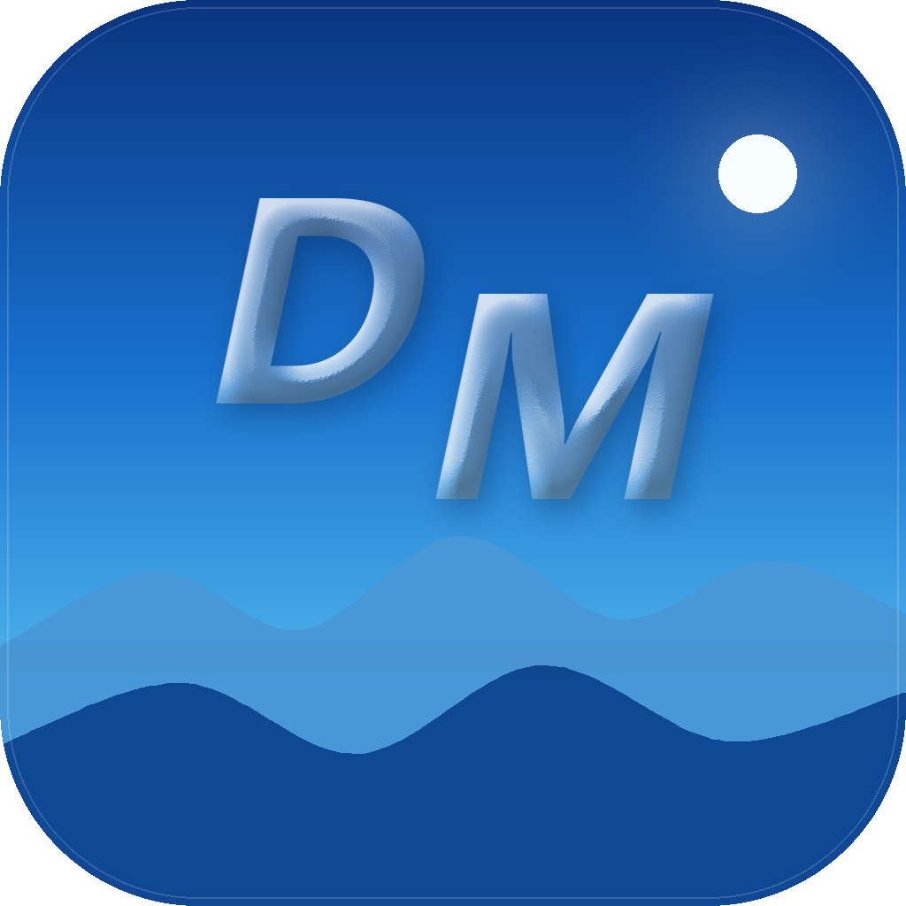

<p align="center">
  <br>
  <b>NovaMac (Stela)</b>
</p>

A translation-based Apple Silicon layer for x86-64 PCs. It is a UEFI boot
program with an arm64-to-x86-64 translator, a Metal driver for NVIDIA GPUs and
a model of Apple silicon hardware. This tree presents itself as an M2 Mac mini
(Mac14,3). It is the **generic** NovaMac tree: no machine ECID, disk GUID or
board-specific configuration is included.

> [!WARNING]
> Experimental. Default-on WiFi (`--wifi-prompt --guest-network`) only enables
> the switches; it does not mean every adapter is driven. Back up your data
> before touching partitions or NVRAM. See `../DISCLAIMER.md`.

## Translator

An ahead-of-time and just-in-time compiler translates arm64e code to x86-64.
It covers more than 3,000 AArch64 instruction encodings, maps guest registers
to host registers and caches translated code.

## NVIDIA driver

The Metal driver compiles AIR, Metal's shader IR, directly to NIR, Mesa's IR,
and supports the Metal3 and Apple7 GPU families.

## NovaMac changes in this tree

- DM-ROOT logo and `NovaMac` name in the EFI boot UI
- Quiet boot page: phase `n/5` + current step; full logs stay in `boot.log`
  and are expanded on screen only when the boot stops
- Real pixel progress bar: grey track with blue fill, indeterminate until a
  step supplies a real fraction (the kernel's file copy)
- Chinese menu glyphs and default-on WiFi in `Options::default()`

## Hardware requirements

| Part | Requirement |
|---|---|
| CPU | Intel or AMD x86-64-v2 (Intel Nehalem, AMD Bulldozer or newer). AVX2 and AVX-512 are used when present. |
| Memory | 8 GB or more. |
| Firmware | 64-bit UEFI with Secure Boot off. |
| GPU | NVIDIA GeForce GTX 16 or RTX 20, 30, 40 or 50 series. |
| Disk | NVMe, or SATA in AHCI mode. 60 GB or more for macOS: a GPT partition or a whole disk to erase. |
| USB stick | 8 GB for the Online installer, 32 GB for the Offline installer. |
| Ethernet | Intel I225/I226/I210/I211/I350/82574L/82575/82576/82579/82580/I217/I218/I219; Realtek RTL8111/8168/8169/8411/8125/8126; Killer E2600/E3000; Broadcom BCM5720/5761/5762; Aquantia AQC100/107/108/109/111/112/113/114/115C/116C; Qualcomm Atheros AR8131/8132/8151/8152/8161/8162/8171/8172, Killer E2200/E2400/E2500; USB: RTL8152/8153/8156, ASIX AX88179/AX88178A/AX88772, CDC ECM and NCM. |
| Wi-Fi | Switches on by default. AX211 / CNVio2 (`8086:51f0`) is currently refused by the `Family::Ax200` gate; the working path is `--guest-network` bridging a host adapter. |
| Bluetooth | Not currently supported. |
| Audio | Not currently supported. |
| USB | xHCI (USB 3) and EHCI controllers, hubs, USB disks. |
| Input | USB keyboards and mice. PS/2 keyboards, mice and Synaptics or Elantech touchpads. |

## Build

You need Rust 1.99.1, git, Python 3.10 or newer, and LLVM 21 with Clang, LLD
and libclang. On macOS, Xcode's Apple clang 21 or newer also works.

```sh
git clone https://github.com/DanMianBenMian/NovaMac-Stela
cd NovaMac-Stela/NovaMac
cargo xtask dist
```

This writes `target/release/stela`. The first build fetches and compiles Linux,
Mesa and LLVM sources and takes a long time. For the EFI only:

```sh
STELA_RELEASE=1 cargo xtask boot build --release
```

## Install / update / logs

The CLI is still called `stela`. It writes the USB stick and reads logs; see
the upstream command syntax (unchanged):

```sh
sudo ./stela                      # choose USB + installer
sudo ./stela update               # update an existing stick
sudo ./stela log --output log.txt # save the boot log for a report
```

On Windows, run the same commands with `.\stela.exe` in an elevated Terminal.
A boot log from a quiet page still contains every line: only the screen is
quiet, the UART and `EFI/stela/boot.log` are not.

## Legal

NovaMac contains no Apple software. You are responsible for following Apple's
software license agreement and terms of use. This is an independent fork; the
upstream author has stated they do not endorse forks. See `../LICENSE`,
`../NOTICE` and `../DISCLAIMER.md`.

## Issues

https://github.com/DanMianBenMian/NovaMac-Stela/issues
